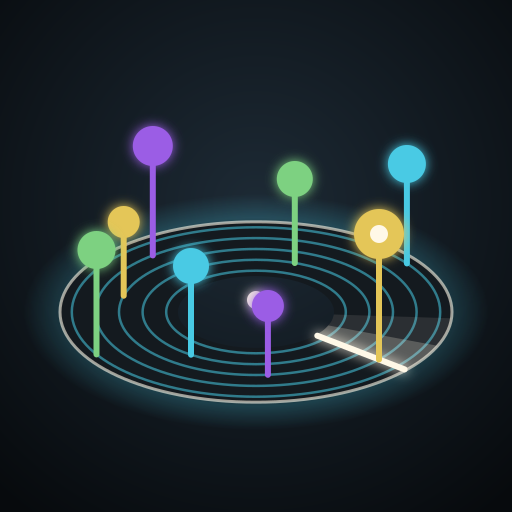
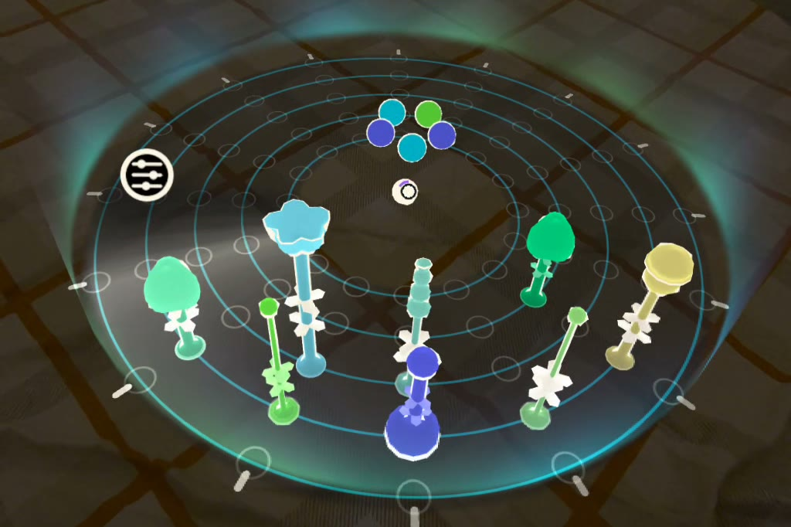
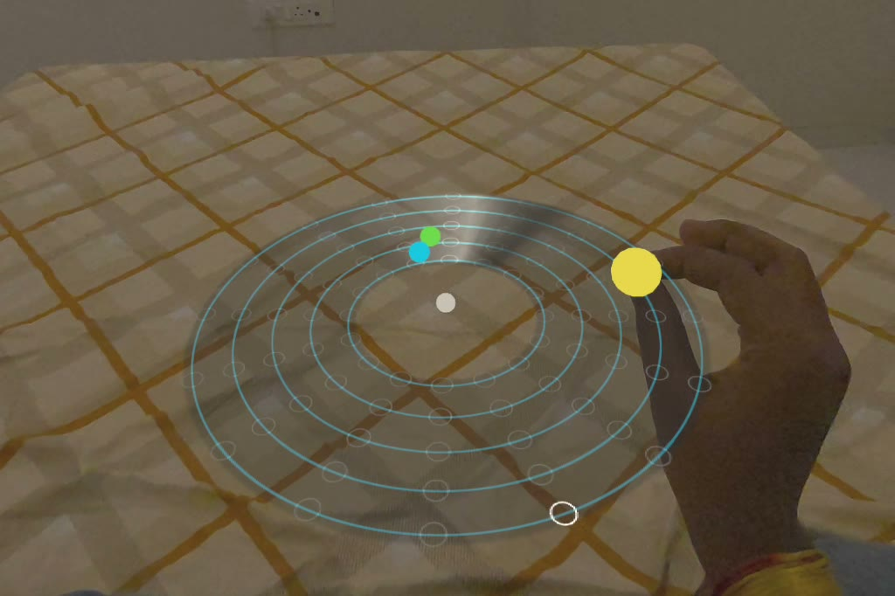
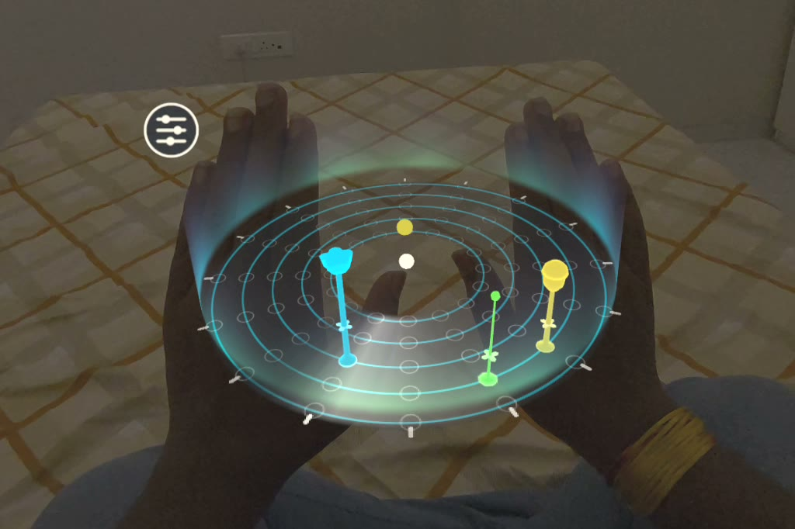

<p align="center">
  
</p>

<h1 align="center">SonicSpace</h1>

<p align="center">
  <b>Grow a song on your table.</b><br />
  A hands-only mixed reality music garden for Meta Quest 3 and 3S.
</p>

<p align="center">
  <a href="https://parthdalvi2001.github.io/SonicSpace/"></a>
</p>

<p align="center">
  
  
  
  
  
  
</p>

<p align="center">
  
</p>

<p align="center"><i>Headset capture from Meta Quest. Every plant is a note; the ring of light plays them.</i></p>

---

## What is SonicSpace?

SonicSpace turns a real table into a glowing, ring-shaped garden. You pinch glowing seeds into the ring, a ring of light
sweeps around it, and every plant sings. **Where** you plant sets **when** it plays (16 steps around the ring) and **how
high** (5 rings). Pull a plant up to make it louder, slide it to move it, drag it off to remove it, and pinch the petal
it leaves to bring it back. Hold your palms out to **Listen**: the room dims and the neon effect rises while you sit back.

After a room scan (Space Setup), **your room tunes the song**: its size sets the key and the echo. Your garden is saved
on the headset and grows over days: three seeds to start, then one new seed each day.

Entry for the **Meta VR Start Developer Competition 2026** (Entertainment track, New Experience division).

<table>
  <tr>
    <td width="50%"></td>
    <td width="50%"></td>
  </tr>
  <tr>
    <td align="center"><b>Pinch to plant</b>: the ring of light plays each seed.</td>
    <td align="center"><b>Palms out to Listen</b>: the neon effect rises.</td>
  </tr>
</table>

## Highlights

| | |
|---|---|
| ✋ **Hands only** | No controllers, no account. Pinch, pull, slide, drag. |
| 🎵 **Every sound is synthesized live** | Web Audio oscillators, noise and filters. No recorded samples, no music files. |
| 🏠 **The room tunes the song** | After Space Setup, room size sets the key and echo. Without a scan you hear a default song. |
| 🧭 **Guided first run** | A strict tutorial with dotted neon arrows, one gesture per step. "Skip tutorial" is always there. |
| 🌱 **Ten seed kinds** | Two sets: Classic (bell, pluck, choir, pad, bass) and Calm. |
| ♿ **Accessible** | One hand, look to select (no hands), high contrast, reduce motion, beat ring. |
| 💾 **Yours, on your headset** | Saved locally; nothing leaves the device. Works offline once loaded. |

## Play it

You need a **Meta Quest 3 or 3S** and **Meta Quest Browser**, with hand tracking on and the controllers put down.

1. Run **Space Setup** first, or look at your table and pinch when asked. Sit at a table.
2. Open **https://parthdalvi2001.github.io/SonicSpace/** and press **Enter the garden**; allow hands and room.
3. Follow the dotted neon arrows: palm up, plant, pull, slide, drag off, undo, Listen and back, the settings orb.
4. **Palm up for a seed.** Three to start, then one a day, like a real garden.
5. **Settings:** turn the back of your other hand towards you and pinch the small orb. The Garden tab has Seeds, Move,
   Time-lapse (a preview of days passing; plants made while it is on are not kept) and Exit.

## Run it locally

Requirements: **Node.js 24** (see `.nvmrc`; 20.19+ and 22.12+ also work) and npm.

```bash
git clone https://github.com/ParthDalvi2001/SonicSpace.git
cd SonicSpace
npm install
npm run dev        # IWSDK dev server and a managed browser with the IWER emulator (Runtime / Editor toggle)
```

| Command | What it does |
|---|---|
| `npm run dev` | Dev server with the IWER headset emulator |
| `npm run verify` | Typecheck, lint, unit tests, build and the build checks (green before every commit) |
| `npm test` | Unit tests (Vitest) |
| `npm run test:e2e` | Browser scenarios in the emulator (Playwright + IWER), see [tests/e2e/README.md](tests/e2e/README.md) |
| `npm run build` / `npm run preview` | Production build in `dist/` and a local preview of it |

Scene, asset and XR-feature configuration is declarative in `iwsdk.config.json`; systems are registered in
`src/index.ts`. IWER controls: https://iwsdk.dev/guides/02-testing-experience.html#iwer-controls

## How it is built

| Layer | Tech |
|---|---|
| XR and scene | [Immersive Web SDK](https://iwsdk.dev) (WebXR, ECS), Three.js |
| Language and build | TypeScript, Vite |
| Sound | Web Audio: a look-ahead scheduler, synthesized voices, one reverb, a limiter |
| Tests | Vitest (about 2,090 unit tests), Playwright + IWER emulator (over 130 browser scenarios) |
| Hosting | GitHub Pages, built by GitHub Actions |

```text
src/
├── hands/        hand tracking, pinch and gestures
├── garden/       the garden model and rules (bed, plants, seeds, days)
├── audio/        synthesis, the scheduler, music theory, echo
├── room/         room scan, table and placement, the room signature
├── render/       Three.js visuals: bed, plants, ring of light, Listen glow
├── ui/           captions, hints, the settings board, the landing page
├── onboarding/   the guided first run
├── access/       look to select, one hand, contrast, motion, beat ring
├── window/       the garden in a plain browser window (mouse or touch), for a laptop preview
├── persistence/  local save (IndexedDB) and migrations
└── core/         shared types, settings, strings
```

## Tested

Played hands-only by the team on a **Meta Quest 3S** and a **Meta Quest 3** (7 to 12 Nov 2026), at about 90 fps. What was
seen on a headset and what was checked only in the emulator is listed in
[specs/05-testing/TEST_PLAN.md](specs/05-testing/TEST_PLAN.md) §4.6. The submitted build is tag `v1.0.0-rc2`
(commit `8f5cf62`); the live site's `/version.json` shows it.

## Team

| | |
|---|---|
| **Parth Dalvi** | Developer |
| **Chinmay Gavade** | Product Manager |

Most of the code and documents were written with an AI coding assistant (Claude Code) under our direction, design and
review; see [specs/06-release/THIRD_PARTY_LICENSES.md](specs/06-release/THIRD_PARTY_LICENSES.md) §5. The app itself uses
no AI and no online service. The working name was Roomsong; saved data and code identifiers keep it.

More: [project documents](specs/README.md) · [current status](specs/08-status/PROGRESS.md) ·
[how Claude Code works in this repo](CLAUDE.md)

## Licence and copyright

Copyright (c) 2026 Parth Dalvi and Chinmay Gavade. All rights reserved: the code is public to be viewed, run and
judged, not to be copied or reused without permission. See [LICENSE](LICENSE).

Third-party code keeps its own licence: see
[specs/06-release/THIRD_PARTY_LICENSES.md](specs/06-release/THIRD_PARTY_LICENSES.md) and [LICENSES/](LICENSES/). The live
site serves each third-party licence text at https://parthdalvi2001.github.io/SonicSpace/LICENSES/&lt;name&gt;.txt (for
example [three.txt](https://parthdalvi2001.github.io/SonicSpace/LICENSES/three.txt)).
